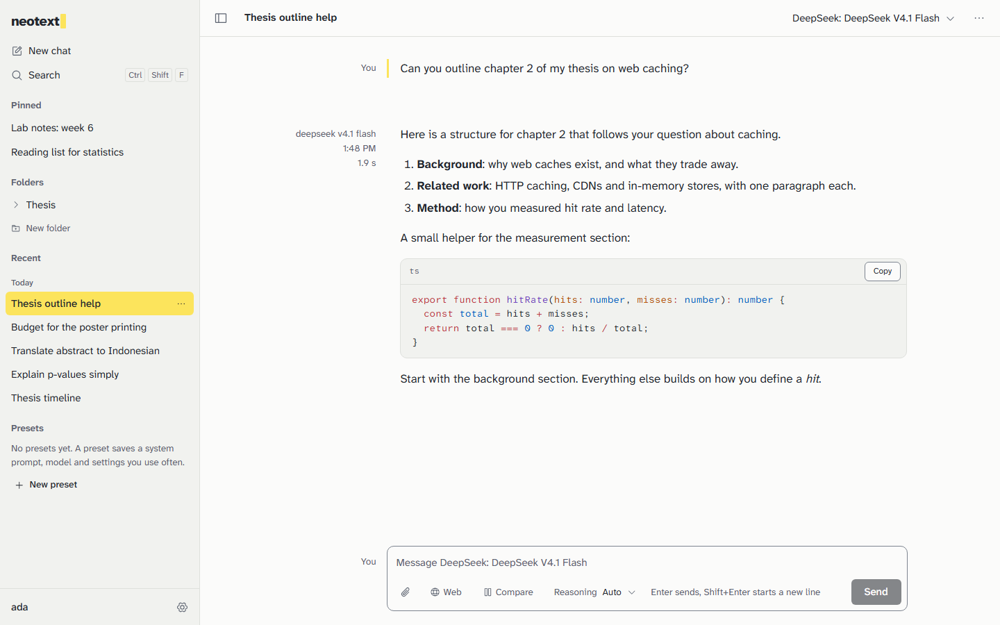

# NeoText

NeoText is a chat app you run yourself: every model in one place with the price on screen, answers that survive a closed tab, and chats encrypted on your own server.



More pictures: [dark theme](assets/screenshots/chat-dark.png), [web search with sources](assets/screenshots/sources.png), [two models side by side](assets/screenshots/compare.png), [a rearranged sidebar](assets/screenshots/sidebar-custom.png).

Version 0.3.0. It is used and tested every day, and the [changelog](CHANGELOG.md) lists what is new and the gaps that are still open.

## Contents

- [Why NeoText](#why-neotext)
- [Quick start](#quick-start)
- [Connect a provider](#connect-a-provider)
- [Community mode](#community-mode)
- [Configuration](#configuration)
- [Security](#security)
- [Backups and upgrades](#backups-and-upgrades)
- [FAQ](#faq)
- [Working on NeoText](#working-on-neotext)
- [License](#license)

## Why NeoText

If you already use ChatGPT, Claude or DeepSeek on their websites, this is what would change.

| What you get | What it looks like |
|---|---|
| Every model in one place | A picker over 400+ models from OpenRouter, plus any server that speaks the OpenAI API (Ollama, LM Studio, vLLM, llama.cpp and others). Switch model in the middle of a chat, or regenerate an answer with a different one. |
| The price before you send | The model sheet shows the price per million tokens. Each message, chat and day shows its cost, and you can set budgets. Light use of a cheap model is cents a day, not a monthly subscription. |
| Compare answers | Send one question to up to four models, read the answers side by side, and continue with the one you prefer. |
| Answers do not get lost | The server keeps writing an answer when you close the tab, and the page picks it up when you come back. Regenerating keeps every version. Deleted chats stay in the trash for 30 days. |
| Your data, your key | Messages, titles, settings and API keys are encrypted with a key that only your password or recovery key can unlock. No telemetry, and the browser contacts no third-party sites. |
| Your layout | Sidebar sections you order, hide or create, the sidebar on either side, density, fonts, accent colour, keyboard shortcuts and presets. English and Bahasa Indonesia. |
| Real tools | Web search with numbered citations, reading web pages, MCP servers for your own tools, and an approval prompt before anything risky runs. |
| Agents | Sub-agents that split a big job and work in parallel, your own agents with Markdown instructions that you call with `@Name`, and a knowledge base of PDF, Word and text files each agent can search. |
| Web projects | Ask for a small web page and the model writes its HTML, CSS and JavaScript. A panel beside the chat runs it offline, keeps every version, and downloads it as one file. |
| Room for a group | One server for a study group or a lab: invites, a provider key the admin shares without showing it, and a spending limit per person. |
| Moving in and out | Import chats from ChatGPT and Claude. Export your data as an encrypted NeoText file, Markdown or JSON. |

What it is not: a way to hide your questions from the model. See [What the model provider can see](#what-the-model-provider-can-see).

## Quick start

You need Node.js 24.7 or newer and `git`. Using Docker instead? Skip to the second block.

### With Node

```bash
git clone https://github.com/DarylLoudi/NeoText.git neotext
cd neotext
npm ci --ignore-scripts
npm run build
npm start
```

Open <http://localhost:3420>. A new server shows a setup page: choose "Just me", pick a username and a long passphrase, and save the recovery key it shows you. That key is the only way back in if you forget your password.

Keep `--ignore-scripts`. The database library (better-sqlite3) ships ready-made binaries, but without the flag npm tries to compile it and fails on a machine with no C++ build tools.

`npm start` reads a `.env` file if there is one. You do not need one to begin. To change the port or anything else, copy `.env.example` to `.env` (`cp .env.example .env`, or `Copy-Item .env.example .env` in PowerShell). The [configuration table](#configuration) lists every setting.

Press Ctrl+C to stop the server. Your data stays in the `data/` folder.

### With Docker

```bash
git clone https://github.com/DarylLoudi/NeoText.git neotext
cd neotext
cp .env.example .env
docker compose up -d --build
```

Open <http://localhost:3420>. The data lives in a Docker volume called `neotext-data`. The port is only reachable from the same machine; to reach it from elsewhere, put a reverse proxy in front (see [Security](#security)). `docker-compose.yml` has a commented Caddy section that sets up HTTPS for you.

## Connect a provider

NeoText needs somewhere to send your questions. Add one under Settings, Providers, Add provider. Keys are stored encrypted and never go back to the browser.

**OpenRouter** (one key for hundreds of models)

1. Make an account at openrouter.ai, add a little credit, and create an API key.
2. In NeoText choose "OpenRouter API", paste the key and save. You can also paste it on the last step of the first-run setup.
3. Press Test connection, then pick a model in the top bar of a new chat.

If you run the server yourself, you can set `OPENROUTER_API_KEY` in `.env` instead. The setup page then offers "Use the OpenRouter key from this server".

**Ollama** (models on your own computer, nothing to pay per message)

1. Install Ollama and download a model, for example `ollama pull llama3.2`.
2. In NeoText choose "OpenAI-compatible". Set the base URL to `http://localhost:11434/v1` and leave the key empty.
3. Press Test connection. The models Ollama has downloaded appear in the picker.

If NeoText runs in Docker, `localhost` means the container, not your computer. Use `http://host.docker.internal:11434/v1` on Docker Desktop, or your computer's network address on Linux.

Addresses on your own network (like Ollama's) are allowed in "Just me" mode and for admins in community mode. LM Studio, vLLM, llama.cpp, Groq and others work the same way: use their OpenAI-compatible address as the base URL.

## Community mode

Community mode lets a group share one NeoText, with you as the admin.

1. Choose "For a group" on the first-run setup page.
2. Add your provider key under Settings, Providers, and switch on "Share with everyone on this NeoText". Members can use it without seeing the key.
3. Under Admin, Instance, set Sign-ups to "Invite only". "Closed" lets nobody in; "Open" lets anyone with the address sign up.
4. Under Admin, Invites, create an invite and send the code. Each code works once and is shown only when you create it.
5. Set a spending limit. Under Admin, Instance, set the default shared budget, and change it for one person in Admin, Users. Limits count only what is spent through the shared key, per day and per month (UTC).

Put the server behind HTTPS before inviting anyone. Also read the note on password escrow in Admin, Instance. It is off by default: a member who loses both their password and recovery key then loses their chats, and you cannot fix that. With it on, you can reset passwords, and anyone holding the database and the server key can read everyone's chats.

## Configuration

Settings are environment variables in a `.env` file in the project folder. `npm start` and Docker both read it, and every setting is optional.

| Variable | Default | What it does |
|---|---|---|
| `NEOTEXT_PORT` | `3420` | The port the server listens on. |
| `NEOTEXT_HOST` | `127.0.0.1` | The address to listen on. Use `0.0.0.0` in a container. Keep the default when a proxy on the same machine is the only way in. |
| `NEOTEXT_DATA_DIR` | `./data` | Where the database, backups, attachments and the server key live. |
| `NEOTEXT_PUBLIC_URL` | `http://localhost:<port>` | The address people open, for example `https://chat.example.com`. With `https`, cookies are marked secure. |
| `NEOTEXT_ALLOWED_ORIGINS` | none | Extra browser origins allowed to call the API, comma separated. Rarely needed. |
| `NEOTEXT_COOKIE_SECURE` | on when the public URL is https | Force secure cookies on (`true`) or off (`false`). |
| `NEOTEXT_TRUST_PROXY` | `false` | `true` only behind a proxy that overwrites `X-Forwarded-For`, so rate limits see real client addresses. |
| `NEOTEXT_LOG_LEVEL` | `info` | `fatal`, `error`, `warn`, `info`, `debug`, `trace` or `silent`. Logs never contain chat text or keys. |
| `NEOTEXT_WEB_DIST` | `apps/web/dist` | The folder with the built web app. |
| `NEOTEXT_ARGON2_MEMORY_KIB` | `65536` | Memory for password hashing, in KiB. Lower it only on a very small host. |
| `NEOTEXT_ARGON2_PASSES` | `2` | Passes for password hashing. |
| `NEOTEXT_BACKUP_INTERVAL_HOURS` | `6` | Hours between automatic backups (1 to 596). |
| `NEOTEXT_BACKUP_KEEP` | `10` | How many scheduled backups to keep. |
| `NEOTEXT_BACKUP_KEEP_PREMIGRATION` | `5` | How many backups taken before a database upgrade to keep. |
| `NEOTEXT_INSTANCE_KEY` | made for you | A 32-byte base64 key that protects what the server holds for everyone (shared provider keys, invite codes, escrow). Unset, NeoText creates `data/keys/instance.key`. |
| `NEOTEXT_ATTACHMENT_QUOTA_MB` | `2048` | Attached-file storage per person, in MB. |
| `OPENROUTER_API_KEY` | none | A key the setup page can offer, and the key `npm run test:live` uses. |
| `NODE_ENV` | `production` for `npm start` and Docker | Leave it alone unless you work on NeoText. |

## Security

### Reporting a problem

Please report security problems privately, not in a public issue: on GitHub, use **Security → Report a vulnerability**. Say what you found, how to reproduce it and which version you ran. Expect an answer within a week, and a fix or a clear plan within 30 days. Never include real API keys, passwords or chat text; fake ones are enough.

### What NeoText protects against

- **A stolen database or backup.** Each person's chats, titles, folders, presets, settings, attachments and provider keys are encrypted with their own data key (AES-256-GCM, bound to its table, column and row). That key is only unlocked by their password, their recovery key, or a live session.
- **Password guessing.** Argon2id, rate limits per address and per username, and the same response time for unknown users.
- **Session theft and cross-site requests.** An `HttpOnly`, `SameSite=Strict` cookie holding a random 256-bit token (the server keeps only its hash), plus an origin check on every request that changes something. You can see and end your other sessions.
- **Scripts in model output or web pages.** Markdown is rendered without raw HTML, under a strict content security policy. Links are limited to safe schemes, and remote images load only when you click, so a prompt injection cannot leak data through an image.
- **Reaching private networks.** Custom endpoints, web page fetching, favicons and MCP only speak http(s); addresses are checked when connecting, private ranges are blocked for tools, and cloud metadata addresses are always blocked.
- **Risky tool calls.** Each tool has a policy (`auto`, `ask` or `off`), tools that write ask first, and tool results are treated as untrusted text. Sub-agents only get web search and page reading, never more than 6 at once, with a shared search budget.
- **Leaking keys.** API keys never go back to the browser, are redacted in logs, and `npm run lint` scans tracked files for anything shaped like a key.
- **One person exhausting the server.** Size limits on request bodies, per-person rate limits (300 API calls a minute, 4 answers at once), a storage cap for attachments, and bounded imports.

The web project preview runs in a sandboxed frame with its own origin, no network access and no access to NeoText.

Stored in plain text: ids, timestamps, model names, token counts, costs, sizes, usernames and the audit log, which records events and never content.

### What the model provider can see

Encryption on your server hides nothing from the model. To answer, NeoText sends your prompt, the earlier messages in that chat and any files you attach to the provider you chose. They see it as plain text, and their own policy decides what they keep. A web search provider sees the search words. If a conversation must stay private, use a model on your own machine.

Whoever runs the server can also read chats if they want to, because they control the code that handles your password. Use a server run by someone you trust, or run your own. NeoText does not protect against a compromised browser or device either.

### Running a server safely

- Use HTTPS and set `NEOTEXT_PUBLIC_URL=https://…`. The Caddy example in `deploy/` gets a certificate for you.
- Keep `NEOTEXT_HOST=127.0.0.1` and let the reverse proxy be the only way in.
- Turn on `NEOTEXT_TRUST_PROXY` only behind a proxy that replaces `X-Forwarded-For` (the Caddy example does). A proxy that appends to it lets clients dodge the rate limits.
- Back up `data/keys/instance.key` (or `NEOTEXT_INSTANCE_KEY`) apart from the database backups. Stored together, they open shared keys and escrow for whoever takes both.
- Keep `.env` private; it may hold `OPENROUTER_API_KEY` or `NEOTEXT_INSTANCE_KEY`.
- Upgrade when a release fixes a security problem, and run `npm run audit` now and then.
- Think before turning on escrow: with it, the database plus the instance key are enough to read every person's data.

## Backups and upgrades

**Backups.** NeoText backs up the database every 6 hours into `data/backups/` and keeps the last 10. Before upgrading the database it takes one more and keeps the last 5 of those. Keep your own copies of two things, in different places: the `data/` folder and the instance key.

To restore, stop NeoText, copy a file from `data/backups/` over `data/neotext.db`, delete `neotext.db-wal` and `neotext.db-shm` next to it if they exist, and start NeoText again.

**Upgrades.** Back up first, then:

```bash
git pull
npm ci --ignore-scripts
npm run build
npm start
```

With Docker: `git pull`, then `docker compose up -d --build`.

The database is upgraded on start, after a backup. Going back to an older version is not supported; restore the backup taken before the upgrade instead. Saved settings are upgraded the same way, and the last 50 versions are kept in Settings, Data.

**Export.** Settings, Data, Export gives you an encrypted NeoText file, Markdown or JSON. Attached files and knowledge-base files are not included yet, and imported chats ask you to choose a model again.

## FAQ

**Why not just use ChatGPT?**
If it already does what you need, you may not need this. NeoText is for when you want to choose among models, see what each answer costs, keep your chats on a server you control, or share one budget with a group. It is also more work: you run a server and bring your own provider.

**What does it cost?**
NeoText is free and open source (MIT). You pay your model provider by the token at their prices, and the app shows the price before you send. A few short chats a day with an inexpensive model cost cents. Local models through Ollama cost nothing per message but need a computer that can run them.

**What if I forget my password?**
Choose "Forgot your password?" on the sign-in page and enter your username and recovery key. That sets a new password and gives you a new recovery key. If you lost both, nobody can read your chats, the admin included, unless the admin turned on escrow.

**Can I delete my account?**
Not yet. You can delete your chats and export your data. If you run the server, deleting the `data/` folder removes everything.

**How big is it?**
The first page load is about 290 KiB of compressed JavaScript. Syntax highlighting, math, settings and other heavy parts load only when needed. The goal is 180 KiB.

## Working on NeoText

Bug reports, translations and pull requests are welcome. Be kind and patient with each other: harassment, insults and publishing someone's private information are not tolerated in issues, pull requests or anywhere else the project lives, and the maintainers may remove such posts or block their authors.

### Set up

```bash
git clone https://github.com/DarylLoudi/NeoText.git neotext
cd neotext
npm ci --ignore-scripts
npm run dev
```

`npm run dev` starts the API on <http://localhost:3420> and the web app with hot reload on <http://localhost:5173>. Open the 5173 address. You do not need a real provider for most work: the tests use a mock one.

| Command | What it does |
|---|---|
| `npm run lint` | Biome, the file-size rule, and the scan for key-shaped strings |
| `npm run typecheck` | TypeScript in every workspace |
| `npm test` | Unit and integration tests |
| `npm run test:e2e` | Browser tests with Playwright (builds the web app first; run `npx playwright install chromium` once) |
| `npm run test:live` | A few real OpenRouter calls with the key in `.env`; costs cents, never runs in CI |
| `npm run build` | Production build of the web app |
| `npm run check:bundle` | Fails when the first-load JavaScript is over 290 KiB |
| `npm run bench` | Server latency and sign-in time against their budgets |

### How the code is laid out

```
apps/server/     Hono API, streaming, providers, tools, encryption, SQLite with Drizzle
apps/web/        React 19 app, CSS Modules with design tokens
packages/shared/ Zod schemas and helpers both sides use
scripts/         dev, start, size checks, bench, screenshots
docs/            the manual QA checklist run before a release
```

A few rules keep it easy to change:

- `apps/web` and `apps/server` never import each other; both import `@neotext/shared`.
- In the server, routes call services, services call repos, and only repos touch the database. Each feature folder has its own routes, service, repo and tests.
- User content is encrypted with the user's data key before it is written. Copy an existing repo, such as `apps/server/src/chat/messages-repo.ts`, when you write a new one.
- Every visible string is translated in English and Indonesian. Indonesian uses "kamu", not "Anda".
- The UI uses the tokens and primitives in `apps/web/src/ui`, works with the keyboard and respects reduced motion.
- Source files stay under 400 lines and tests under 500. Split a file by what it does rather than trimming comments.

### Adding things

- **A provider** for an API that is not OpenAI-compatible: add the kind in `packages/shared/src/providers.ts`, implement `ProviderAdapter` in `apps/server/src/providers/<name>/adapter.ts`, register it in `providers/registry.ts`, and add it to the provider form. Test against the mock provider with recorded streams, after removing keys and personal text from them.
- **A tool:** write a `ToolDefinition` in `apps/server/src/tools/builtin/` with its test, fetch only through `ctx.http` so private addresses stay blocked, and pick the safest default policy. Anything that writes or sends data should be `ask`.
- **A setting:** add it with a default in `packages/shared/src/settings/schema.ts`; old documents get the default. Renaming or removing one needs a migration in `migrations.ts` and a test that starts from the old document.
- **A database change:** edit `apps/server/src/db/schema/`, then run `npm run db:generate -w @neotext/server -- --name <name>`. Never edit generated migrations by hand.
- **A language:** copy `en.json` and `en.pages.json` in `apps/web/src/lib/i18n/locales/`, translate them, and register the code in `i18n/index.ts` and the `locale` setting. A parity test catches missing keys.

### Things that catch people out

- Browser tests run against `apps/web/dist`, so a source change is invisible to them until you rebuild.
- The API allows 300 requests a minute per user; a script that opens many pages in a row will hit it.
- Anything exported from `apps/web/src/ui/index.ts` lands in the first chunk, and the first-load budget is full. Load rarely used pieces lazily and import radix from subpaths (`radix-ui/popover`).
- Strings for Settings and Admin live in `en.pages.json`/`id.pages.json` and load with those pages; everything else goes in `en.json`/`id.json`.
- The web-search test "a remote image … loads only after a click" is flaky. Run it again before blaming your change.
- Check UI changes at 360 px wide and in dark mode. The responsive test fails when a page scrolls sideways.

### Sending a change

- Write the failing test first when you fix a bug. Use fake keys such as `sk-or-test-...`, never a real one.
- Run `npm run lint`, `npm run typecheck` and `npm test`. For UI changes, also run `npm run test:e2e` and look at the result in both themes and at phone width.
- Keep one change per commit, with a short message in the style of the history: `feat: …`, `fix: …`, `docs: …`.
- Add a line to `CHANGELOG.md` under Unreleased for anything a user would notice.
- CI runs lint, types and tests on Linux and Windows, the browser tests, the bundle budget and a Docker build. All of them must pass.

## License

MIT. See [LICENSE](LICENSE).
