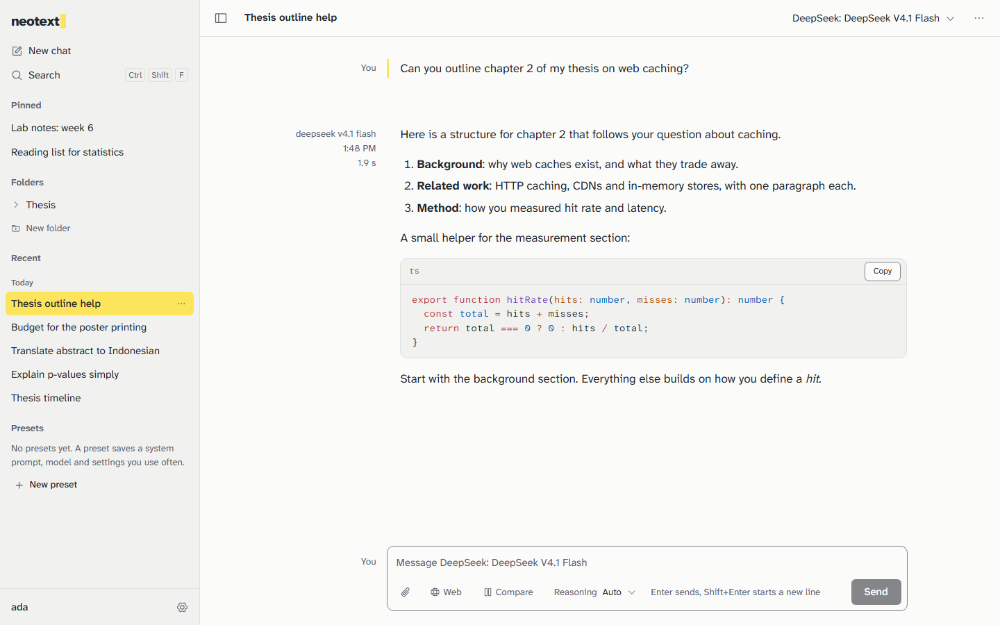

# NeoText

NeoText is a chat app you run yourself: every model in one place with the price on screen, answers that survive a closed tab, and chats encrypted on your own server.



More pictures: [dark theme](docs/images/chat-dark.png), [web search with sources](docs/images/sources.png), [two models side by side](docs/images/compare.png), [a rearranged sidebar](docs/images/sidebar-custom.png).

Status: version 0.1.0, the first release. It is used and tested, and it has [known gaps](CHANGELOG.md#known-gaps) that this page repeats where they matter.

## Why NeoText

If you already use ChatGPT, Claude or DeepSeek on their websites, this is what would change.

| What you get | What it looks like |
|---|---|
| Every model in one place | A picker over 400+ models from OpenRouter, plus any server that speaks the OpenAI API (Ollama, LM Studio, vLLM, llama.cpp and others). Switch model in the middle of a chat, or regenerate an answer with a different one. |
| You pay for what you use, and see the price first | The model sheet shows the price per million tokens before you send. Each message, chat and day shows its cost. You can set budgets. Light use of a cheap model is cents a day, not a monthly subscription. |
| Compare answers | Send one question to up to four models and read the answers side by side. Continue the chat with the one you prefer. |
| Answers do not get lost | The server keeps writing an answer if you close the tab, and the page picks it up when you come back. Regenerating keeps every version. Deleted chats stay in the trash for 30 days. Your settings are saved in versions you can restore. |
| Your data, your key | Messages, titles, settings and API keys are encrypted on the server with a key that only your password (or your recovery key) can unlock. There is no telemetry and the browser contacts no third-party sites. |
| Your layout | Sections in the sidebar that you order, hide or create (smart folders that fill themselves), the sidebar on either side, density, fonts, accent colour, keyboard shortcuts, and presets (saved system prompts and settings). English and Bahasa Indonesia. |
| Real tools | Web search with numbered citations and source cards, reading web pages, MCP servers for your own tools, and an approval prompt before anything risky runs. |
| Agents | Sub-agents that work on parts of a big job in parallel, and your own agents with Markdown instructions that you call with `@Name` or let the model use. |
| Room for a group | One server can serve a study group or a lab: invites, a provider key the admin shares without showing it, and a spending limit per person. |
| Moving in and out | Import your chats from ChatGPT and Claude. Export your own data as an encrypted NeoText file, Markdown or JSON. |

What it is not: a way to hide your questions from the model. See [What the model provider can see](#what-the-model-provider-can-see).

## Quick start

You need Node.js 24.7 or newer, and a way to run `git`. Using Docker instead? Skip to the second block.

### With Node

Replace the address with where you got the code.

```bash
git clone <repository address> neotext
cd neotext
npm ci --ignore-scripts
npm run build
npm start
```

Open <http://localhost:3420>. A new server shows a setup page: choose "Just me", pick a username and a long passphrase, and save the recovery key it shows you. That key is the only way back in if you forget your password.

`--ignore-scripts` matters. The database library (better-sqlite3) comes with ready-made binaries, but without this flag npm tries to compile it from source, which fails on a machine with no C++ build tools.

`npm start` uses your settings from a `.env` file if there is one. You do not need one to begin. To change the port or anything else, copy `.env.example` to `.env` first (`cp .env.example .env` on Linux and macOS, `Copy-Item .env.example .env` in Windows PowerShell). The [configuration table](#configuration) lists every setting.

To stop the server, press Ctrl+C. Your data stays in the `data/` folder.

### With Docker

```bash
git clone <repository address> neotext
cd neotext
cp .env.example .env
docker compose up -d --build
```

Open <http://localhost:3420>. The data lives in a Docker volume called `neotext-data`. The port is only reachable from the same machine; to reach it from elsewhere, put a reverse proxy in front (see [Security](#security)). `docker-compose.yml` has a commented Caddy section that sets up HTTPS for you.

## Connect a provider

NeoText needs somewhere to send your questions. You add one under Settings, Providers, Add provider. Keys are stored encrypted and are never sent back to the browser.

**OpenRouter** (the easy start, one key for hundreds of models)

1. Make an account at openrouter.ai, add a little credit, and create an API key.
2. In NeoText choose the service "OpenRouter API", paste the key, and save. You can also paste it on the last step of the first-run setup.
3. Press Test connection. Then pick a model in the top bar of a new chat.

If you run the server yourself, you can instead set `OPENROUTER_API_KEY` in `.env`. The setup page then offers "Use the OpenRouter key from this server".

**Ollama** (models on your own computer, no key, no cost per message)

1. Install Ollama and download a model, for example `ollama pull llama3.2`.
2. In NeoText choose "OpenAI-compatible" as the service. Set the base URL to `http://localhost:11434/v1`. Leave the key empty.
3. Press Test connection. The models Ollama has downloaded appear in the picker.

If NeoText runs in Docker, `localhost` means the container, not your computer. Use `http://host.docker.internal:11434/v1` on Docker Desktop, or your computer's network address on Linux.

Addresses on your own network (like Ollama's) are allowed in "Just me" mode and for admins in community mode. LM Studio, vLLM, llama.cpp, Groq and others work the same way: use their OpenAI-compatible address as the base URL.

## Community mode in five steps

Community mode lets a group share one NeoText. You are the admin.

1. Choose "For a group" on the first-run setup page.
2. Add your provider key under Settings, Providers, and switch on "Share with everyone on this NeoText". Members can use it without seeing the key. Only admins can change it.
3. Under Admin, Instance, set Sign-ups to "Invite only". "Closed" lets nobody in; "Open" lets anyone with the address sign up.
4. Under Admin, Invites, create an invite and send the code to the person. Each code works once and is shown only when you create it. They open your NeoText and choose "Create an account".
5. Set a spending limit so nobody empties your credit. Under Admin, Instance, set the default shared budget, and change it for one person in Admin, Users. Limits count only what is spent through the shared key, per day and per month (UTC). Members who add their own key are not limited.

Put the server behind HTTPS before inviting anyone ([Security](#security)). Also read the note on password escrow in Admin, Instance. It is off by default: with it off, a member who loses both their password and recovery key loses their chats, and you cannot fix that for them. With it on, you can reset passwords, and anyone who holds the database and the server key can read everyone's chats.

## Configuration

Settings are environment variables. Put them in a `.env` file in the project folder (`npm start` and the Docker setup both read it). All of them are optional.

| Variable | Default | What it does |
|---|---|---|
| `NEOTEXT_PORT` | `3420` | The port the server listens on. |
| `NEOTEXT_HOST` | `127.0.0.1` | The address to listen on. Use `0.0.0.0` inside a container. Keep the default when a proxy on the same machine is the only way in. |
| `NEOTEXT_DATA_DIR` | `./data` | Where the database, backups, attachments and the server key live. |
| `NEOTEXT_PUBLIC_URL` | `http://localhost:<port>` | The address people type in the browser, for example `https://chat.example.com`. When it starts with `https`, cookies are marked secure. |
| `NEOTEXT_ALLOWED_ORIGINS` | none | Extra browser origins allowed to call the API, comma separated. You rarely need this. |
| `NEOTEXT_COOKIE_SECURE` | on when the public URL is https | Force secure cookies on (`true`) or off (`false`). |
| `NEOTEXT_TRUST_PROXY` | `false` | Set to `true` only behind a proxy that overwrites `X-Forwarded-For`, so rate limits see real client addresses. |
| `NEOTEXT_LOG_LEVEL` | `info` | `fatal`, `error`, `warn`, `info`, `debug`, `trace` or `silent`. Logs never contain chat text or keys. |
| `NEOTEXT_WEB_DIST` | `apps/web/dist` | The folder with the built web app. |
| `NEOTEXT_ARGON2_MEMORY_KIB` | `65536` | Memory used to hash passwords, in KiB. Lower it only on a very small host; it makes passwords easier to guess. |
| `NEOTEXT_ARGON2_PASSES` | `2` | Passes used to hash passwords. |
| `NEOTEXT_BACKUP_INTERVAL_HOURS` | `6` | Hours between automatic backups (1 to 596). |
| `NEOTEXT_BACKUP_KEEP` | `10` | How many scheduled backups to keep. |
| `NEOTEXT_BACKUP_KEEP_PREMIGRATION` | `5` | How many backups taken before a database upgrade to keep. |
| `NEOTEXT_INSTANCE_KEY` | made for you | A 32-byte key in standard base64 that protects data the server holds for everyone (shared provider keys, invite codes, escrow). If unset, NeoText creates `data/keys/instance.key`. |
| `NEOTEXT_ATTACHMENT_QUOTA_MB` | `2048` | How much attached-file storage each person gets, in MB. |
| `OPENROUTER_API_KEY` | none | A key the setup page can offer to use, and the key `npm run test:live` uses. Not needed if you add the key in Settings. |
| `NODE_ENV` | `development`; `production` for `npm start` and Docker | Leave it alone unless you are developing NeoText. |

## Security

The short version, with the details in [SECURITY.md](SECURITY.md):

- Your chats, titles, settings, attachments and provider keys are encrypted in the database. The key that unlocks them comes from your password; a second copy is unlocked by your recovery key. A stolen database file or backup does not give up your data.
- Passwords are hashed with Argon2id. Sign-in is rate limited. Cookies cannot be read by scripts and are not sent from other sites.
- Model answers are shown without raw HTML, under a strict content security policy. Remote images load only when you click.
- Servers you point NeoText at (custom endpoints, web page fetching, MCP) cannot be used to reach private networks or cloud metadata addresses, except for the local endpoints you allow as an admin.
- Run it behind HTTPS if it is reachable from the internet. The Caddy example in `deploy/` does this and gets the certificate for you.

### What the model provider can see

Encryption on your server does not hide anything from the model. To answer, NeoText sends your prompt, the earlier messages in that chat, and any files you attach to the provider you chose (OpenRouter, and behind it the company that runs the model, or your Ollama). They see it as plain text, and their own policy decides what they keep. The same goes for a web search provider if you use one: it sees the search words. If a conversation must stay private, use a model on your own machine.

The person who runs your server can also read your chats if they want to, because they control the code that handles your password. Use a server run by someone you trust, or run your own.

## Backups and upgrades

**Backups.** NeoText backs up the database every 6 hours into `data/backups/`, and keeps the last 10. Before it changes the database for an upgrade it takes one more backup, and keeps the last 5 of those. Back up two things yourself, and keep them in different places: the `data/` folder (or a backup file), and `data/keys/instance.key` (or your `NEOTEXT_INSTANCE_KEY`). Without the instance key, shared provider keys and escrow cannot be opened.

To restore, stop NeoText, copy a file from `data/backups/` over `data/neotext.db`, delete `neotext.db-wal` and `neotext.db-shm` next to it if they exist, and start NeoText again.

**Upgrades.** Back up first, then:

```bash
git pull
npm ci --ignore-scripts
npm run build
npm start
```

With Docker: `git pull`, then `docker compose up -d --build`.

The database is upgraded for you on start, after a backup. Going back to an older version after that is not supported; restore the backup taken before the upgrade instead. Your saved settings are upgraded the same careful way, and the last 50 versions are kept in Settings, Data.

**Export.** Settings, Data, Export gives you an encrypted NeoText file, Markdown or plain JSON. Two limits to know about: attached files are not included in NeoText exports (the app tells you how many were left out), and provider ids are not remapped when you import, so imported chats ask you to choose a model again.

## FAQ

**Why not just use ChatGPT?**
If it already does what you need, you may not need this. NeoText is for when you want to choose among models, see what each answer costs, keep your chats on a server you control, share one account budget with a group, or keep a long chat history that a vendor cannot change under you. It is also more work: you run a server, and you bring your own provider and keys.

**What does it cost?**
NeoText is free and open source (MIT). You pay your model provider for what you use, by the token, at the provider's prices; the app shows the price before you send and the cost after. A few short chats a day with an inexpensive model are cents. Long chats, large attachments and the most capable models cost more. Local models through Ollama cost nothing per message, but need a computer that can run them. You also pay for wherever you host NeoText, if not on your own laptop.

**What if I forget my password?**
Choose "Forgot your password?" on the sign-in page and enter your username and the recovery key you saved at setup. That sets a new password and gives you a new recovery key. If you lost both, your chats cannot be read by anyone, including the admin, unless the admin turned on password escrow. In that case the admin can reset your password and keep your chats. Save the recovery key somewhere other than the same computer.

**Can I delete my account?**
Not yet. There is no account deletion in 0.1.0. You can delete your chats and export your data. If you run the server, deleting the `data/` folder removes everything.

**How big is it?**
The first page load downloads about 327 KiB of compressed JavaScript. The target is 180 KiB, and it is not met yet; see the [changelog](CHANGELOG.md#known-gaps). Heavy parts such as syntax highlighting, math and settings load only when needed.

## Contributing

Bug reports, translations and pull requests are welcome. [CONTRIBUTING.md](CONTRIBUTING.md) explains how to set up the project, where things live, and how to add a provider, a tool, a setting or a language. Please follow the [Code of Conduct](CODE_OF_CONDUCT.md). Report security problems privately, as described in [SECURITY.md](SECURITY.md).

## License

MIT. See [LICENSE](LICENSE).
